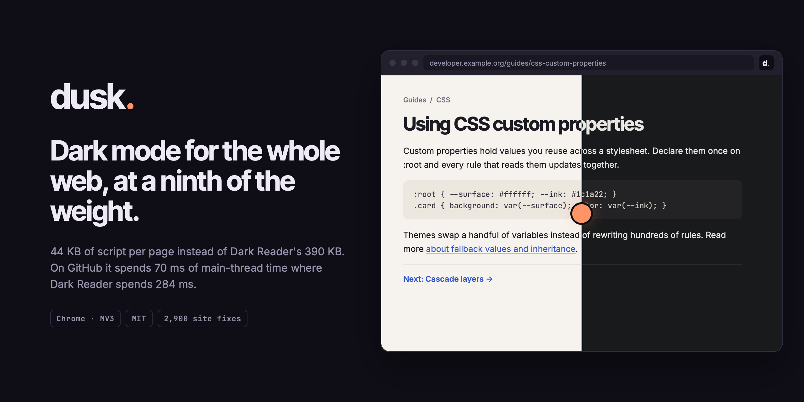
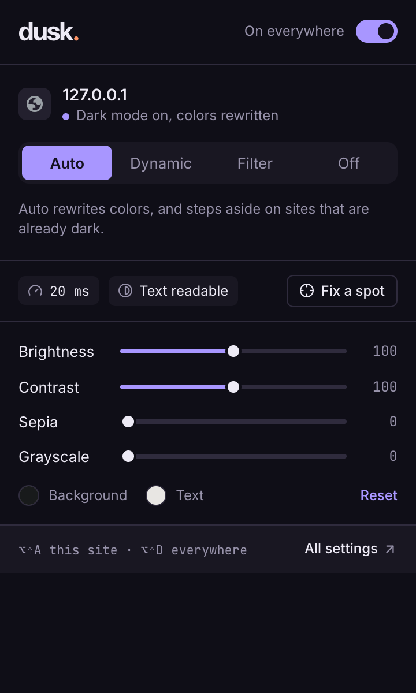
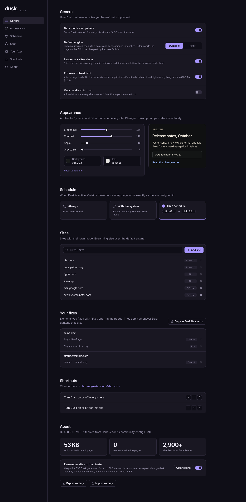
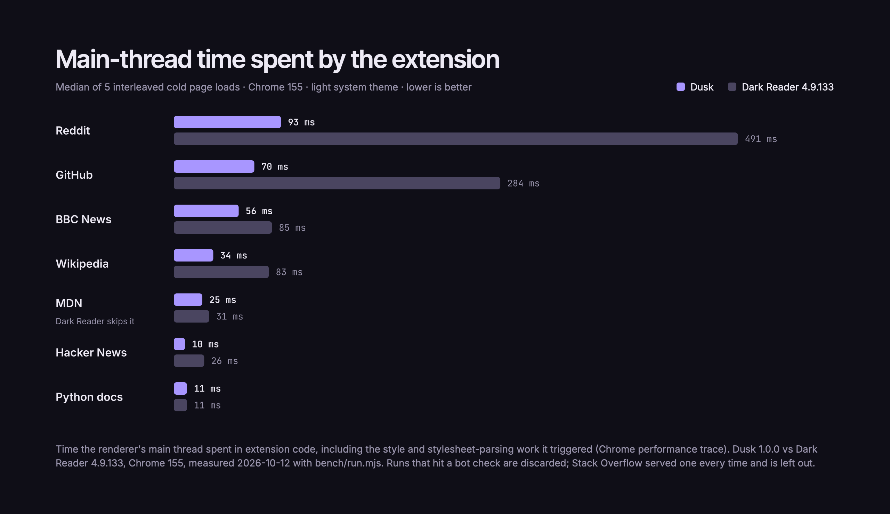

<p align="center"></p>

# Dusk

Dark mode for every website, built to cost as little as possible.

Dusk does what [Dark Reader](https://github.com/darkreader/darkreader) does (and reuses its MIT-licensed site fixes), but it is engineered around one constraint: the page you are reading should not pay for its dark mode.

## What only Dusk does

- **It uses the site's own dark theme, even behind a toggle.** Many sites ship a complete dark design that only appears when you click their theme switch (`.dark`, `data-theme="dark"`, `data-bs-theme`...). Dusk finds the hook in the site's CSS, sets it, and checks that the page really went dark. In a survey of 30 popular sites it used the site's own theme on 19 (16 behind a toggle, 3 through `prefers-color-scheme`). Nothing is written to the site's storage, and the site's original setting is restored when Dusk is off.
- **It shows what it costs.** The popup reports the main-thread time Dusk's own work took on the page you're on.
- **It checks that text is actually readable.** After a page loads, Dusk measures visible text against what's really painted behind it and lightens anything below WCAG AA (4.5:1, or 3:1 for large text).
- **"Fix a spot."** If a logo vanishes or an image glares, click it and choose Invert or Dim. The fix is saved for that site, can be undone, and can be copied in Dark Reader's config format to contribute upstream.

## Features

- **Dynamic mode:** rewrites the site's colors. It covers stylesheets (same- and cross-origin), CSS variables (including aliases and Tailwind's `rgb(… / var(--tw-bg-opacity))`), gradients, shadows, `@media`/`@layer`/`@supports`/`@container`/nesting, keyframes, inline styles, `bgcolor`/`fill`/`stroke` attributes, shadow DOM (open roots, `adoptedStyleSheets`, declarative), and CSS-in-JS that inserts rules through the CSSOM.
- **Background-image analysis:** dark icons drawn as CSS backgrounds (PNG, SVG, data URIs) are recolored so they don't disappear. Decoding and pixel work happen in the background worker, never on the page's thread.
- **Native dark themes:** when a site ships its own `prefers-color-scheme: dark` theme, Dusk turns that on instead of approximating it.
- **Already-dark detection:** dark sites are left alone. Dusk decides this by reading the site's CSS, not by re-rendering the page.
- **Filter mode:** inverts the page with a GPU filter and puts media back.
- **Per-site modes:** Auto, Dynamic, Filter or Off, plus an allow-list mode ("only on sites I turn on").
- **Adjustments:** brightness, contrast, sepia, grayscale, and custom background and text colors.
- **Scheduling:** always on, follow the system theme, or a time range.
- **Dark Reader's site fixes:** 2,900 sites' worth of `INVERT`/`CSS`/`IGNORE INLINE STYLE` entries and its dark-sites list.
- Respects `<meta name="darkreader-lock">`.
- Settings page with every option, a live palette preview, per-site modes, your fixes, settings export/import and cache control.
- Keyboard shortcuts: <kbd>Alt+Shift+D</kbd> toggles everywhere, <kbd>Alt+Shift+A</kbd> toggles the current site.

## Privacy

No analytics, no telemetry, no servers. The only requests Dusk makes go to stylesheets and images the current page already uses, without cookies. Nothing is cached in Incognito. Details are in [PRIVACY.md](PRIVACY.md).

## Popup and settings

<p> </p>

Every view (five popup states, the settings page, adding a site, the empty site list) is designed in `design/dusk.mat` first. `npm run ui` screenshots the real views and puts each next to its design in `bench/out/ui/compare-*.png`.

## Why it's lighter

- **The mode is known synchronously at `document_start`:** the background registers a one-line flag script per mode, so the right engine starts before storage answers.
- **No DOM nodes are added:** overrides are `adoptedStyleSheets`, one per source sheet, shared by every shadow root that uses that sheet.
- **Elements are never touched:** inline styles are overridden by rules keyed on the attribute's value (`[style="…"]`).
- **Repeat visits use a cache:** generated CSS is cached per origin and applied before the page's stylesheets parse.
- **Sites with their own dark theme get it turned on,** so nothing is rewritten and their variables aren't even read.
- **"Is this site already dark?" is read from the site's `html`/`body` rules,** with no forced style recalculation.
- **Before `DOMContentLoaded`, Dusk polls the sheet count once per frame** instead of observing every parsed node.
- **Work is memoized per rule and per sheet.** Each memo records whether it used CSS variables or image verdicts, so only those parts are redone.
- **Only roots whose sheets changed are reprocessed,** which matters on pages with hundreds of web components.
- **Images are analyzed in the background worker** with OffscreenCanvas, never on the page's thread.
- **Site fixes are looked up in the background worker;** a page receives only its own entry.

## Benchmarks



Dusk injects 44 KB of script into each page (15 KB gzipped); Dark Reader injects about 390 KB. The picker is a separate 9 KB file, loaded only when you use it. Dusk is lighter than Dark Reader on every site measured and ties on Python docs. Dark Reader doesn't darken MDN at all. Each number is the median of 5 interleaved cold loads; runs that hit a bot check are discarded. Run it yourself with `npm run bench` (raw numbers land in `bench/out/results.json`).

## Develop

```sh
npm install
npx puppeteer browsers install chrome   # only for the browser tests and benchmarks
npm run dev         # rebuilds dist/ on change (unminified, with sourcemaps)
npm run build       # production build into dist/
npm test            # unit tests + real-browser tests (Chrome for Testing)
npm run bench       # Dusk vs Dark Reader vs nothing, on real sites
```

The brand, popup and options designs, README images and store graphics live in `design/dusk.mat` (MateUI); exports are in `docs/images/`.

Load `dist/` from `chrome://extensions` (Developer mode → Load unpacked).

### Layout

| File | What it does |
|---|---|
| `src/background.ts` | Registers content scripts per mode, proxies cross-origin CSS, serves site fixes, caches CSS per origin, handles shortcuts |
| `src/content.ts` | Picks the engine for the page and reacts to settings |
| `src/dynamic.ts` | The dynamic engine: sources, passes, inline styles, shadow roots |
| `src/generate.ts` | Walks CSS rules and emits overrides; reads native dark themes |
| `src/transform.ts` | Rewrites colors inside any CSS value; property roles; var() redirection |
| `src/color.ts` | Color parsing and the dark palette math |
| `src/detect.ts` | Already-dark detection |
| `src/images.ts` | Background-image analysis (runs in the background worker) |
| `src/filter.ts` | Filter mode |
| `src/main-world.ts` | Page-world hooks for CSSOM changes and shadow roots |
| `src/fixes.ts`, `tools/fixes.mjs` | Dark Reader site-fix conversion and lookup |

### Site fixes

`vendor/darkreader-config/` holds Dark Reader's configs at a pinned tag (MIT, see the LICENSE there). To refresh them, run `node tools/fixes.mjs --update`.

## Known gaps

- Firefox isn't supported yet. The build targets Chrome 120+ (MV3, `world: "MAIN"` content scripts).
- `` elements aren't analyzed, only CSS backgrounds (same as Dark Reader). Site fixes cover popular logos.
- Closed shadow roots can't be reached by any extension.
- Per-site settings live in `chrome.storage.sync`, which caps one item at 8 KB, so roughly 250 sites.
